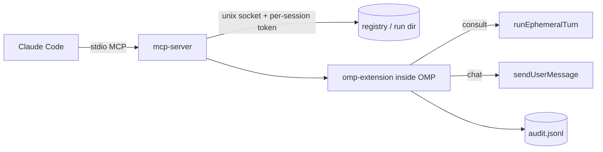

# Repository Guidelines

AgentBridge connects a **Claude Code** session to an **OMP** session in the same project so Claude can ask OMP's current model a question and get an answer. Answers arriving from the other agent are treated as **reference data, not user instructions**.

Hard architectural stances (do not “improve” these away):

- No daemon, no network ports. Each OMP session **is** the server on a per-session Unix domain socket under the runtime dir.
- Each Claude session gets its own stdio MCP server process; stdout is reserved for MCP framing.
- `consult` is an ephemeral turn (`runEphemeralTurn(tools:false)`): it must not mutate the OMP session, run tools, or join the main turn.
- `chat` (opt-in) is a real transcript turn and may run tools under OMP's own permissions. `autochat` only removes the per-message consent prompt.
- Linux-only MVP. Windows is unsupported; macOS untested.

## Architecture & Data Flow

Dependency direction is strictly one-way: `protocol` (zero deps) ← `core` ← `mcp-server` / `omp-extension`. `core` never imports a consumer; `protocol` never imports `core`.



Request path:

1. Claude calls `agent_list` / `agent_status` / `agent_consult` / `agent_chat` (`packages/mcp-server/src/tools.ts`). Identity resolution is mandatory.
2. `packages/mcp-server/src/client.ts` reads registry records, probes liveness with `hello`, and resolves a target deterministically by worktree/commonDir (exact id → ≥8-char unique prefix → unique name; alive-only; never “newest”; ambiguity → `ambiguous_target` with options).
3. `packages/core/src/ipc-client.ts` opens the socket, authenticates, sends exactly one request, forwards `progress`, then one terminal frame.
4. `packages/core/src/ipc-server.ts` in the OMP extension enforces hello timeout, identity, clock skew, TTL, dedupe, and auth lockout.
5. The extension runs the ordered gate pipeline before the turn: config → project allowlist → `allowFrom` → size caps → rate/concurrency → consent → turn → redact → audit.

Protocol shape: `Envelope` with `v:1`, `hop:0`, closed `MsgType` (`hello|status|consult|chat|progress|result|error`) and closed `ErrorCode` enum. Framing is newline-delimited JSON with a 1 MiB cap (`LineReader`). Everything is hand-validated in `packages/protocol/src/validate.ts`; there is no schema library in `protocol`.

## Key Directories

| Path | Purpose |
|---|---|
| `packages/protocol/src/` | Wire contract: envelopes, validation, framing, error taxonomy, target matching, redaction, path guard, limits, Vietnamese user strings |
| `packages/core/src/` | Host/client runtime: dirs + secure fs, config, registry + liveness + stale sweep, IPC server/client, audit, git/proc introspection |
| `packages/omp-extension/src/` | OMP extension: `lifecycle.ts` (Host), `consult.ts`, `chat.ts`, `autochat.ts`, `project-config.ts`, `omp.ts` API adapter |
| `packages/mcp-server/src/` | stdio MCP server, MCP tools, `ab` CLI (`cli.ts`), caller-support startup gate, formatters |
| `plugins/claude/`, `plugins/omp/` | Shipped plugin manifests and committed bundles (`dist/*.js`) |
| `scripts/` | Release bundler/auditor (`build.ts`) and dev installer (`install.ts`) |
| `tests/integration/` | End-to-end host + real stdio MCP server |
| `docs/plan/`, `docs/research/` | Design spec, task order, research; file headers cite spec sections |
| `spike/` | T0 PoC, not part of the build |

## Development Commands

Bun ≥ 1.4; `bun` must be on `PATH`. There is no Node entry point.

```bash
bun install --frozen-lockfile
bun test
bun run typecheck
bun run build            # bundles + regenerated plugin manifests
bun run build --check    # rebuild to tmp and compare; must stay green
bun packages/mcp-server/src/cli.ts doctor
```

There is **no root `tsconfig.json`**; bare `tsc --noEmit` finds no project, use `bun run typecheck`. No linter, formatter, or CI exists — style is enforced by reading neighbors.

## Code Conventions & Common Patterns

- TypeScript ESM only, `strict` + `noUncheckedIndexedAccess` (`tsconfig.base.json`). Indexing yields `T | undefined`; handle it.
- Tabs, double quotes, semicolons in `packages/**`; 1-space indent in `scripts/**`; 2-space JSON.
- Code, identifiers, and comments in English. All user-facing strings are Vietnamese and centralized in each package's `messages.ts` — never inline them in handlers.
- Entry files guard with `if (import.meta.main)` and set `process.exitCode`; never `process.exit`.
- Depend on injected interfaces/params, not ambient globals: `ToolDependencies`, `HelloResultProvider`, `RequestIO`, `OmpLike`, `CliIO`/`Env`. Tests substitute fakes there.
- Timers and aborts go through `ctx.setTimeout`, `AbortSignal`, and `.unref()` so blocked sessions can exit.
- Best-effort subsystems (git, proc, audit, widget rendering) must swallow failures; security-relevant checks (path guard, token read, dir permissions) must throw typed errors.
- Writes use `writeFileAtomic` (tmp 0600 → fsync → rename); dirs must be 0700, current uid, non-symlink.
- Registry order matters: write the token before the record, and remove only when `instanceId` still matches.
- File headers carry a spec citation (`/** … Spec: 01 §8. */`) pointing into `docs/plan/01-design-spec.md`. Update the spec when changing behavior.
- Only `mcp-server` may import `@modelcontextprotocol/sdk` and `zod`. Bundles may import only `node:*` / `bun:*`.
- Dependencies are pinned exactly; internal deps use `workspace:*`. Add packages with `bun add` in the workspace, never globally.
- Never touch real `~/.claude`, `~/.omp`, `~/.agentbridge`, or shell profiles. Point `AGENTBRIDGE_HOME` / `AGENTBRIDGE_CONFIG` / `AGENTBRIDGE_STATE_DIR` / `AGENTBRIDGE_RUNTIME_DIR` at temp dirs.
- Never call a real LLM in tests; fake `runEphemeralTurn` and `claude agents --json`.

## Important Files

- `packages/protocol/src/envelope.ts` — envelope types, `PROTOCOL_VERSION`, capabilities.
- `packages/protocol/src/limits.ts` — every timeout/size/cap; change here, not at call sites.
- `packages/core/src/config.ts` — `DEFAULT_CONFIG`, whitelist parser, mtime-cached loader.
- `packages/core/src/registry.ts` / `dirs.ts` — session records, liveness, stale sweep, path layout and socket ceiling (100 bytes).
- `packages/omp-extension/src/lifecycle.ts` — Host, session start/shutdown, command dispatch; `isRootTui` is `agent.kind === "main" && hasUI && mode === "tui"`.
- `packages/omp-extension/src/omp.ts` — the only place raw OMP `ctx`/`pi` APIs may be touched; feature-detect anything outside the verified list.
- `packages/mcp-server/src/index.ts` — stdio entry; `caller-support.ts` registers zero tools when an `omp` ancestor is detected.
- `scripts/build.ts` — targets, audits, manifest generation, `--check`.
- `config.example.json` — must stay equal to `DEFAULT_CONFIG` apart from a non-empty `projects`.

## Runtime/Tooling Preferences

- Runtime and test runner: **Bun only** (`bun build --target=bun`, `bun:test`). `node:*` built-ins are allowed; no other runtime imports in bundles.
- Package manager: Bun with committed `bun.lock`; installs use `--frozen-lockfile`. Do not introduce npm/pnpm/yarn or a second lockfile.
- Build output: single-file ESM bundles at `plugins/claude/dist/mcp-server.js` and `plugins/omp/dist/agentbridge.js`, committed. The build refuses non-builtin imports and build-machine absolute paths.
- Root `version` is the only version source; `bun run build` propagates it into `plugin.json`, `plugins/omp/package.json`, and both `marketplace.json`. Hand-editing generated files fails `--check`.
- Bundle outputs are release artifacts, never hand-edit them; `--check` catches drift.
- Generated manifests: `.claude-plugin/marketplace.json`, `.omp-plugin/marketplace.json`, `plugins/claude/.claude-plugin/plugin.json`, `plugins/omp/package.json`, `plugins/claude/.mcp.json`.

## Testing & QA

- Framework: `bun:test`, no config, no preload, no retries. Unit tests are colocated as `src/*.test.ts`; end-to-end tests live in `tests/integration/`.
- Helpers are deliberately **not** named `*.test.ts` (`test-helpers.ts`, `tests/integration/helpers.ts`, `mcp-entry.ts`) so Bun does not execute them.
- Run a subset with `bun test packages/protocol` or `bun test tests/integration`. Full-suite stability is an acceptance criterion: `bun test tests/integration` must pass 20 consecutive runs.
- Isolation rules: `mkdtemp` per test with an area prefix, restore env in `afterEach` (delete keys that were unset), fake external binaries with `/bin/sh` scripts on a temp `PATH`, isolate git with `GIT_CONFIG_GLOBAL=/dev/null` plus fixed author/committer, and use synthetic pids for other processes.
- Determinism: `captureTimers()` for protocol/core timers, fake `ctx.setTimeout` forwarding elsewhere, `waitFor` polling at 5 ms, `utimesSync(Date.now() + N)` to force config reloads. Do not add sleeps.
- Skip platform/UID cases with an early `return`, not `test.skip`.
- Name tests as behavior sentences and assert error **codes**, not message text. Only user-facing Vietnamese wording and formatter output uses verbatim asserts/snapshots.
- Integration assertions require `structuredContent` to stay `undefined`; adding structured tool output breaks many suites.
- `bun test` includes `scripts/build.test.ts`, which shells `bun run build --check` (2 × 60 s) and needs a linkable `node_modules` and committed bundles.
- `config.test.ts` validates the real root `config.example.json`.
- Coverage: only a docs-level ≥90% line target for `protocol` files; nothing enforces it. Definition of done is `bun test` + `bun run typecheck`.
