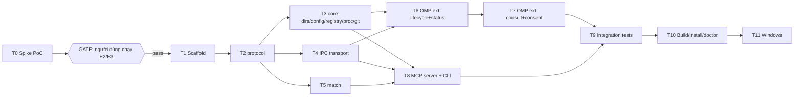

# AgentBridge — Kế hoạch triển khai (tổng quan)

> Căn cứ: `docs/research/` (đặc biệt 01, 05, 06, 08). Plan này **thay thế** những chỗ trong research còn để mở.
> Đặc tả kỹ thuật chi tiết nằm ở `01-design-spec.md`. Task giao cho agent nằm ở `02-tasks.md`.

## 1. Mục tiêu MVP (Giai đoạn 1)

Người dùng mở `claude` và `omp` trong cùng project, rồi nói với Claude: *"hỏi OMP review kiến trúc"*. Luồng mong muốn:

1. Claude gọi tool `agent_list` hoặc `agent_consult` (MCP server `agentbridge`).
2. MCP server tìm **đúng phiên OMP đang mở** (cùng worktree) qua registry và handshake.
3. Extension `agentbridge` chạy trong OMP hỏi người dùng xác nhận (lần đầu), rồi gọi `ctx.runEphemeralTurn()` bằng model hiện tại của OMP. Lịch sử OMP không thay đổi, tool không được thực thi.
4. Câu trả lời được stream về Claude, đóng khung là "dữ liệu từ agent khác".

**Ngoài phạm vi MVP:** delegation (OMP sửa code), inbox OMP → Claude, Channels, file reservation, daemon, SQLite, WSL ↔ Windows, nhiều máy.

## 2. Kiến trúc (chốt)

```
Claude Code ──stdio──► agentbridge-mcp ──UDS / named pipe + token──► agentbridge extension (trong OMP) ──► ctx.runEphemeralTurn
                            │                                              │
                            └──────── đọc registry (file 0600) ◄── ghi ────┘
```
- Không có daemon. Mỗi phiên OMP là **server** của chính nó. Mỗi phiên Claude có **một** tiến trình MCP làm **client**.
- Registry đặt trong thư mục runtime riêng của user, **không bao giờ** nằm trong repo.

## 3. Cấu trúc repo

```
agentbridge/
├─ package.json              # bun workspaces
├─ tsconfig.base.json
├─ bunfig.toml
├─ packages/
│  ├─ protocol/              # KHÔNG dependency runtime. Dùng chung cho cả 2 phía
│  │  └─ src/{envelope,errors,framing,validate,ids,redact,pathguard,match,limits}.ts
│  ├─ core/                  # registry, runtime dirs, liveness, IPC transport (Bun/Node API thuần)
│  │  └─ src/{dirs,config,registry,proc,git,ipc-server,ipc-client,audit}.ts
│  ├─ omp-extension/         # extension; bundle thành 1 file dist/agentbridge.js
│  │  └─ src/{index,lifecycle,consult,consent,status,commands}.ts
│  └─ mcp-server/            # stdio MCP server + CLI debug `ab`
│     └─ src/{index,identity,tools/*,format,cli}.ts
├─ spike/                    # PoC giai đoạn 0 (xóa sau khi có kết quả)
├─ scripts/                  # build, install (in ra lệnh, không tự sửa config global)
└─ docs/{research,plan}/
```

**Lý do tách `protocol` và `core` không có dependency:** extension phải được bundle thành **một file JS** đặt vào `~/.omp/agent/extensions/`. Chỉ `mcp-server` được phép dùng `@modelcontextprotocol/sdk` và `zod`.

## 4. Quy tắc bắt buộc cho agent thực thi (OMP)

1. **Không** sửa `~/.claude/**`, `~/.omp/**`, `~/.agentbridge/**` thật, cũng như shell profile của người dùng. Test dùng thư mục tạm (`mkdtemp`) và biến môi trường `AGENTBRIDGE_HOME` hoặc `AGENTBRIDGE_RUNTIME_DIR`, `AGENTBRIDGE_STATE_DIR`, `AGENTBRIDGE_CONFIG`.
2. **Không** cài package global. Chỉ `bun add` trong workspace.
3. **Không** gọi LLM thật trong test. `runEphemeralTurn` và `claude agents --json` đều phải được fake.
4. **Không** tự nạp extension đang phát triển vào phiên OMP đang làm việc. Test tích hợp với OMP thật do **người dùng** chạy trong một phiên riêng (`omp -e ./packages/omp-extension/dist/agentbridge.js`).
5. **Không** copy code từ dự án AGPL (agent-intercom-*, claude-squad). Được phép tham khảo pi-intercom (MIT), nhưng phải ghi nguồn.
6. Mọi API của OMP phải **đối chiếu với mã nguồn tag `v18.14.0`** (`31147f9d`, `packages/coding-agent/src/extensibility/extensions/types.ts`) trước khi dùng. API ngoài danh sách đã xác minh trong `docs/research/03` thì phải feature-detect.
7. Mỗi task kết thúc khi: `bun test` pass, `bunx tsc --noEmit` pass, và tiêu chí chấp nhận của task đạt. Báo cáo lại: các file đã đổi, lệnh đã chạy kèm output, và mọi chỗ lệch khỏi spec (kèm lý do).
8. Viết code, identifier và comment bằng tiếng Anh. Chuỗi hiển thị cho người dùng dùng tiếng Việt, gom vào `messages.ts` của từng package.

## 4b. Skill dùng chung

Cấu trúc: bản gốc nằm ở `<repo>/.agents/skills/<name>/`, là nơi OMP đọc qua provider `agents`. `<repo>/.claude/skills/<name>` là **symlink** tới bản gốc, để Claude Code đọc. Lý do: config OMP trên máy này có `disabledProviders: [claude, claude-md, claude-plugins, …]`, nên OMP **không** đọc `.claude/`. Thêm skill mới thì làm theo cùng cấu trúc này. Kiểm tra bằng `omp skill list` và `/skills` trong Claude.

| Skill | Nguồn | Dùng ở task |
|---|---|---|
| `omp-extension-v18` | Nội bộ, docs + `types.ts` OMP tag v18.14.0 | **T0, T6, T7, T11**: bắt buộc đọc trước khi gọi API OMP |
| `build-mcp-server`, `mcp-builder` | Anthropic chính thức | **T8** |
| `mcp-integration` | Anthropic chính thức | **T8, T10** (đăng ký MCP) |
| `hook-development` | Anthropic chính thức | GĐ 2 (**T13**, hook `UserPromptSubmit`) |
| `bun-runtime` | affaan-m/ecc | **T1–T4, T6** (bun build/test) |
| `security-threat-model`, `audit-context-building` | OpenAI, Trail of Bits | Review bảo mật sau **T7, T8**, audit trước **T10** |

**Lưu ý:**
- **Không chạy** `mcp-builder/scripts/evaluation.py`, vì nó gọi Anthropic API và vi phạm quy tắc 3.
- Các skill bên ngoài được khóa nguồn và hash trong `skills-lock.json`.
- Skill được cài ở cấp project, không đặt ở `~/.claude/skills`, vì OMP mặc định không đọc thư mục đó (`skills.enableClaudeUser=false`).

## 5. Thứ tự và cổng (gate)


- Làm song song được: **T3, T4, T5** (sau T2), **T6/T7** song song với **T8**.
- Nếu GATE thất bại (gọi `runEphemeralTurn` từ callback socket không được), dừng lại và áp dụng phương án dự phòng ở `02-tasks.md` T0, mục "Nếu thất bại".

## 6. Mẫu prompt giao task cho OMP

```
Bạn đang làm dự án AgentBridge trong repo hiện tại.
Đọc: docs/plan/00-overview.md (quy tắc mục 4), docs/plan/01-design-spec.md, và task <Tx> trong docs/plan/02-tasks.md.
Chỉ làm đúng task <Tx>. Không làm task khác, không mở rộng phạm vi.
Nếu spec mơ hồ hoặc API OMP không khớp mã nguồn v18.14.0: dừng lại và hỏi, đừng đoán.
Khi xong: chạy `bun test` và `bunx tsc --noEmit`, rồi báo cáo các file đã đổi, output test,
và mọi điểm lệch khỏi spec.
```

## 7. Kiểm thử thủ công bởi người dùng (sau T10)

| Bước | Lệnh | Kỳ vọng |
|---|---|---|
| 1 | `bun run build` | Có `packages/omp-extension/dist/agentbridge.js` |
| 2 | Tạo `~/.agentbridge/config.json` với project test (01 §6) | — |
| 3 | `cd /tmp/ab-test && omp -e <repo>/packages/omp-extension/dist/agentbridge.js` | Status bar OMP hiện `🔗 bridge` |
| 4 | `bun <repo>/packages/mcp-server/src/cli.ts list` (từ `/tmp/ab-test`) | Liệt kê phiên OMP và model |
| 5 | `claude mcp add -s local agentbridge -- bun <repo>/packages/mcp-server/src/index.ts` trong `/tmp/ab-test` | — |
| 6 | Mở `claude` trong `/tmp/ab-test` → "hỏi OMP xem phiên của nó đang làm gì" | OMP hỏi xác nhận → Claude nhận câu trả lời |
| 7 | So sánh `sha256sum` file phiên OMP trước và sau | Không đổi |
