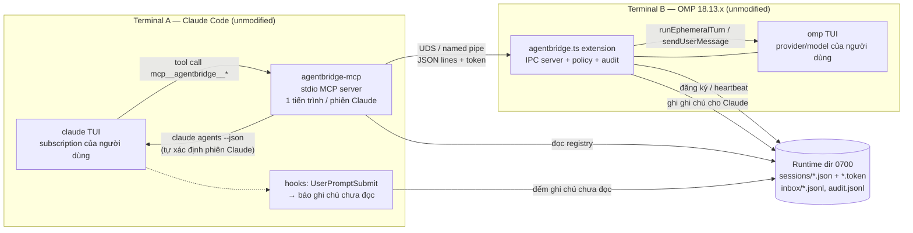
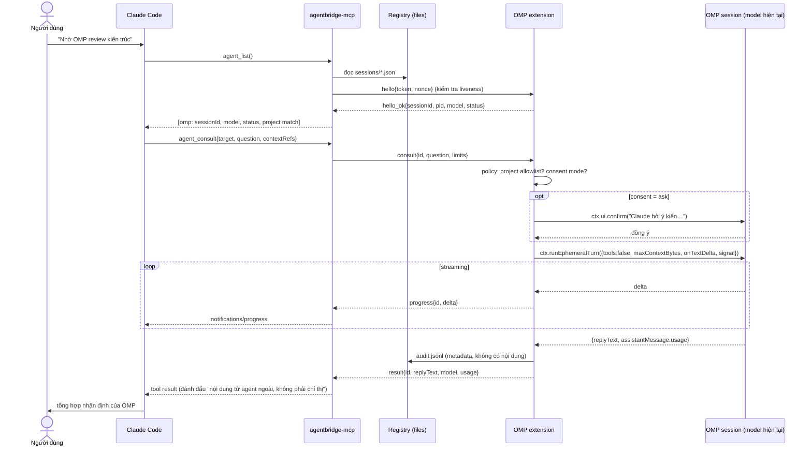
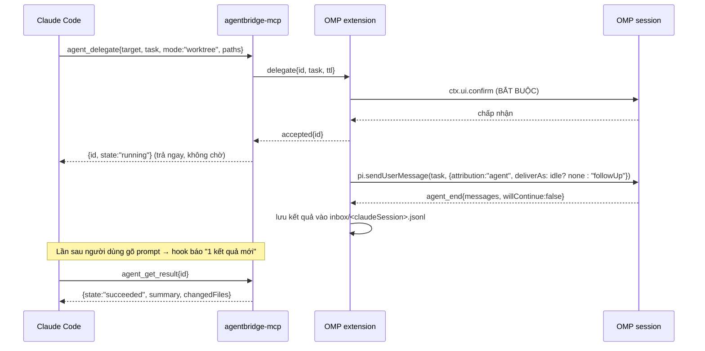
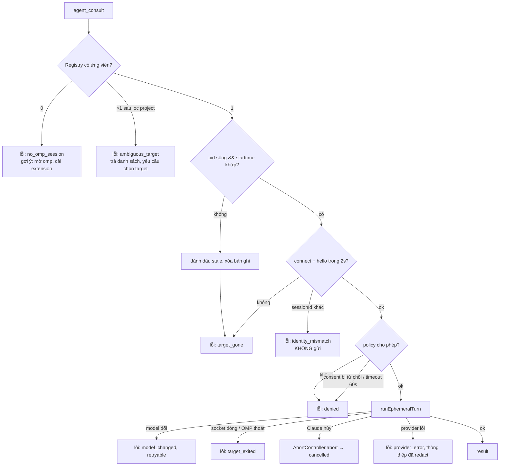

# 05 — Phương án kiến trúc

## 1. Ràng buộc đã kiểm chứng (đầu vào của việc chọn kiến trúc)

1. **OMP:** cách duy nhất vào phiên TUI đang chạy, vừa local vừa có tài liệu, là **extension** (03 §3). RPC không gắn vào phiên có sẵn.
2. **Claude → bên ngoài:** MCP tool là cơ chế chính thức, ổn định và tuân thủ rõ ràng (02 §3, 08). Mỗi phiên Claude spawn một MCP server riêng.
3. **Bên ngoài → Claude (push):** chỉ có Channels (preview, dev flag, phải khởi động kèm) hoặc inbox socket (format không công bố cho peer ngoài). Cả hai đều **kích hoạt inference trên subscription**.
4. **Consultation** có thể chạy trọn vẹn bằng một lời gọi đồng bộ, vì `runEphemeralTurn` trả Promise. Không cần hàng đợi bền vững.

## 2. Các phương án

### A — Daemon local + adapter native
Hook / MCP phía Claude ↔ **daemon AgentBridge** (registry + router + SQLite) ↔ extension OMP.

### B — Thuần MCP
Một MCP server HTTP **dùng chung** mà cả Claude Code lẫn OMP cùng kết nối làm client. Hướng vào OMP dùng `mcp_notification` → `sendUserMessage`. Hướng vào Claude dùng Channels.

### C — Kho tin nhắn dùng chung (SQLite / thư mục)
Hai bên ghi và đọc một mailbox (giống Agent Mail), kèm polling hoặc hook.

### D — Hybrid
Daemon + MCP + extension + channel, mỗi thứ dùng đúng chỗ.

### E — Extension làm chủ IPC, không daemon (**đề xuất thêm**)
- Extension OMP **là server IPC** của chính phiên đó, và ghi một **bản ghi discovery** dạng file JSON vào thư mục runtime riêng của user.
- MCP server phía Claude (mỗi phiên một tiến trình) **là client**: đọc registry, kiểm tra liveness, kết nối trực tiếp.
- Không có tiến trình trung gian.

## 3. Ma trận đánh giá (1 = kém, 5 = tốt)

| Tiêu chí | A Daemon | B Thuần MCP | C Mailbox | D Hybrid | **E Ext-IPC** |
|---|---|---|---|---|---|
| Khả thi với API đã kiểm chứng | 4 | 2 (OMP không làm MCP server; push vào Claude cần Channels) | 4 | 3 | **5** |
| Công sức tích hợp | 2 | 3 | 3 | 1 | **4** |
| Độ tin cậy | 3 (thêm điểm hỏng) | 2 (Channels không ACK) | 4 | 2 | **4** |
| Giữ nguyên phiên | 5 | 3 (cần khởi động lại Claude kèm channel) | 5 | 4 | **5** |
| Hai chiều | 5 | 4 | 4 (kéo) | 5 | 3 (MVP: Claude → OMP đồng bộ; OMP → Claude dạng kéo) |
| Tài nguyên | 3 | 3 | 4 | 2 | **5** (không có tiến trình thêm) |
| Bảo mật | 3 (thêm một socket đặc quyền) | 2 (HTTP localhost dùng chung) | 4 | 2 | **4** (endpoint theo phiên, token theo phiên) |
| Rủi ro chính sách | 3 | 2 (Channels tự kích hoạt Claude) | **5** | 2 | **5** (chỉ người dùng chủ động gọi tool) |
| Đa nền tảng | 4 | 4 | 5 | 3 | 4 (named pipe trên Bun Windows cần thử) |
| Mở rộng (nhiều phiên) | 5 | 3 | 4 | 5 | 4 |
| Bảo trì | 3 | 3 | 4 | 1 | **4** |
| Debug | 3 | 2 | **5** | 2 | 4 |
| Dependency | 2 (SQLite native, dịch vụ nền) | 3 | 3 | 1 | **5** (không dependency native) |
| Khôi phục lỗi | 3 (daemon chết thì mất tất cả) | 2 | **5** | 2 | 4 (lỗi cô lập theo phiên) |
| **Tổng (không trọng số)** | 48 | 38 | 59 | 35 | **60** |

> Điểm số là đánh giá định tính của nhóm nghiên cứu dựa trên bằng chứng ở 02/03/04, không phải số đo. Mục đích là để so sánh tương đối.

**Nhận xét:**
- C (mailbox) mạnh ở độ bền và tuân thủ, nhưng **không trả lời đồng bộ** được: OMP phải tự kéo, mà kéo thì cần một lượt inference của OMP. Do đó C không đáp ứng UX "hỏi rồi nhận câu trả lời ngay".
- **E + một mailbox file tối giản cho hướng OMP → Claude** kết hợp được ưu điểm của cả hai.
- A và D chỉ đáng làm khi cần: hàng đợi bền vững qua lần khởi động lại, nhiều máy, dashboard, hoặc định tuyến nhiều-nhiều.

## 4. Khuyến nghị

- **MVP: Phương án E.** Gồm extension OMP làm chủ IPC, stdio MCP server phía Claude, registry bằng file, và **inbox dạng kéo** cho hướng OMP → Claude. Không daemon, không SQLite.
- **Dài hạn: D giới hạn.** Thêm *daemon tùy chọn* chỉ khi xuất hiện nhu cầu thật: delegation bền vững, nhiều agent khác loại, file reservation dùng chung, push vào Claude (khi Channels ra GA hoặc inbox format được công bố). Giữ nguyên envelope v1 để chuyển đổi không phá vỡ.

## 5. Sơ đồ thành phần (MVP — E)

## 6. Sequence — Consultation (Claude → OMP)

## 7. Sequence — Delegation (giai đoạn 2)

## 8. Luồng xử lý lỗi

## 9. Phương án bị loại

| Phương án | Lý do loại cho MVP |
|---|---|
| B thuần MCP | OMP không có chế độ MCP server. Push vào Claude buộc dùng Channels (preview, dev flag, phải khởi động lại Claude, tự kích hoạt inference) |
| A daemon | Thêm điểm hỏng, cài đặt và giám sát dịch vụ nền, socket đặc quyền. Không cần cho consultation đồng bộ |
| D hybrid đầy đủ | Phức tạp nhất. Giá trị chỉ xuất hiện khi có yêu cầu dài hạn |
| Dùng `/collab` làm lõi | Relay ngoài (vi phạm local-first), giao thức nội bộ |
| Gõ phím qua herdr / tmux | Không theo dõi được lượt, dễ vỡ trước UI phê duyệt, phải đổi terminal |
| Spawn `omp --mode rpc` | Tạo phiên mới, vi phạm yêu cầu "không nhân bản phiên" |
