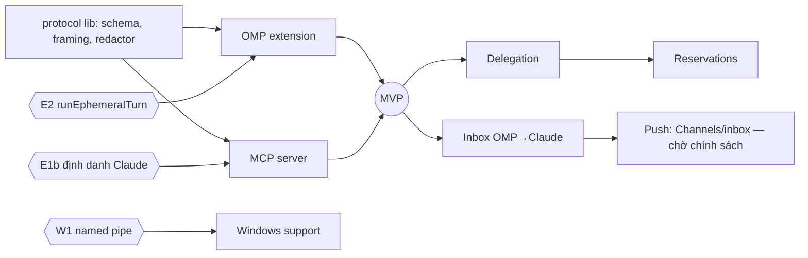

# 10 — Lộ trình triển khai

## 1. Lựa chọn công nghệ

| Tiêu chí | TS + Bun | TS + Node | Rust | Go |
|---|---|---|---|---|
| Tương thích extension OMP | **Bắt buộc**: extension chạy trong Bun của OMP | — | Không | Không |
| MCP SDK | `@modelcontextprotocol/sdk` (TS, chính thức) | như Bun | `rmcp` | `mcp-go` |
| IPC đa nền tảng | `node:net` UDS. Named pipe trên Windows **cần test** | UDS + named pipe ổn định | Rất tốt | Tốt |
| Khởi động | Nhanh | Trung bình | Rất nhanh | Nhanh |
| SQLite | `bun:sqlite` có sẵn | `node:sqlite` | `rusqlite` | `modernc` |
| Đóng gói | Script `.ts` chạy bằng `bun`. Máy này đã có Bun 1.4.4 | `npx` | Binary, cần CI cho từng OS | Binary |
| Native deps | Không | Không | Không | Không |
| Dùng chung code (schema, client) | **Có**, cùng ngôn ngữ với extension | Có | Không | Không |

**Chọn: TypeScript, chạy bằng Bun cho cả hai phía.**
- Extension OMP buộc phải là TypeScript và chạy trong Bun của OMP.
- MCP server viết bằng TS và chạy bằng `bun` để chia sẻ schema protocol và client. Bun đã cài sẵn khi dùng OMP.
- Phương án dự phòng là Node.js cho MCP server nếu Bun Windows có vấn đề với stdio hoặc pipe.
- Không chọn Rust/Go cho MVP, vì tốn hai toolchain mà không mang lại lợi ích gì cho bài toán I/O nhẹ này.

**Có cần daemon?** Không, cho tới GĐ 3. **Có cần SQLite?** Không, cho tới khi có delegation bền vững hoặc reservation đa agent.

## 2. Phạm vi MVP (GĐ 1)

**Trong phạm vi:**
1. Extension OMP `agentbridge.ts` (scope user). Gồm: registry, heartbeat, IPC server, `hello`, `status`, `consult` (qua `runEphemeralTurn`), consent `ask|session`, project allowlist, rate limit, audit metadata, `ctx.ui.setStatus("agentbridge", "🔗 bridge")`.
2. stdio MCP server `agentbridge-mcp` (scope user). Tool: `agent_list`, `agent_status`, `agent_consult`, `agent_cancel` (đóng kết nối). Streaming bằng progress. Tự định danh phiên Claude bằng ppid + `claude agents --json`.
3. Thư viện chung `@agentbridge/protocol`: schema v1, framing, redactor, path guard.
4. Linux trước, Windows ngay sau khi W1 pass.
5. Tài liệu cài đặt: một lệnh `claude mcp add -s user agentbridge -- bun …/mcp.ts`, và copy extension vào `~/.omp/agent/extensions/`.

**Ngoài phạm vi MVP:** delegation, inbox OMP → Claude, Channels, worktree tự động, reservation, daemon, SQLite, đa máy, WSL ↔ Windows.

## 3. Các giai đoạn

| GĐ | Nội dung | Ước lượng | Điều kiện vào |
|---|---|---|---|
| **0. Spike** | Chạy E1b, E2, E3, E6, E8 bằng PoC (09 §4) trong thư mục tạm | 2–3 ngày | Người dùng cho phép dùng token provider |
| **1. MVP Consultation** | Phạm vi §2; test tự động cho registry, matching, protocol (không cần LLM, dùng `runEphemeralTurn` giả) | 1,5–2 tuần | E2 + E3 pass |
| **1W. Windows** | Named pipe + ACL, chuẩn hóa path | 3–5 ngày | W1 pass, hoặc dùng fallback pi-natives |
| **2. Delegation + inbox** | `agent_delegate` (consent bắt buộc, `mode:"worktree"`), `agent_get_result`, `tasks/<id>.json`; inbox kéo + hook `UserPromptSubmit`; tool OMP `bridge_note_to_claude`; `agent_inbox` | 2 tuần | GĐ 1 ổn định ≥ 2 tuần sử dụng thực tế |
| **3. Tùy chọn** | Reservation (Shared Workspace mode); đánh giá Channels hoặc inbox socket cho push (chỉ khi chính sách rõ); daemon + SQLite nếu cần hàng đợi bền vững; adapter cho agent khác | tùy | Nhu cầu thực tế + câu trả lời ở 11 |

## 4. Đồ thị phụ thuộc

## 5. Tiêu chí chấp nhận cho MVP
1. Với một Claude + một OMP cùng worktree, "hỏi OMP review kiến trúc" trả lời trong Claude, với model của OMP được hiển thị trong kết quả.
2. Số tiến trình `omp` không đổi. File phiên OMP **không đổi byte nào** sau consultation.
3. Khi có hai OMP cùng worktree, kết quả là `ambiguous_target` và danh sách. Chỉ định `target` thì tới đúng phiên. Không bao giờ broadcast.
4. Khi OMP đang chạy lượt dài, consult vẫn trả kết quả, và lượt chính không bị gián đoạn (transcript OMP không có steer hay chèn nào).
5. Sau `kill -9` OMP, bản ghi stale được dọn ở lần `agent_list` kế tiếp. Không còn kết nối tới pid sai.
6. Không thể kết nối khi thiếu token đúng. User khác không đọc được thư mục runtime.
7. Khi extension hoặc MCP không có mặt, cả hai agent hoạt động bình thường: không lỗi, không cảnh báo lặp lại.
8. Không có lượt Claude nào bắt đầu mà không có thao tác của người dùng.
9. Audit log không chứa nội dung câu hỏi hay câu trả lời (mặc định).
10. Kiểm thử trên OMP 18.13.3, và extension từ chối an toàn khi thiếu `runEphemeralTurn`.

## 6. Rủi ro và điểm chặn chính
| Rủi ro | Ảnh hưởng | Phương án |
|---|---|---|
| `ctx` không dùng được ngoài event handler (E2) | Chặn kiến trúc | Fallback: đăng ký command `/agentbridge-serve` và dùng `ExtensionCommandContext`, hoặc chạy consult bên trong một handler định kỳ (`ctx.setInterval`) có cancel đúng cách |
| Transport OpenAI/Codex từ chối `maxTokens` | Lượt không có trần output | Chỉ cho phép khi `allowUncappedConsult: true`; giữ `replyMaxBytes` |
| `ctx.ui.confirm` gây gián đoạn hoặc không chạy được khi OMP đang stream | UX kém | Dùng `setWidget`/`notify` + lệnh `/agentbridge allow` |
| OMP đổi API | Hỏng extension | Feature-detect + CI chạy với bản OMP mới |
| Windows pipe | Không chạy trên Windows | `@oh-my-pi/pi-natives` `IpcServer` |

## 7. Ước lượng độ phức tạp
- MVP: **khoảng 1.200–1.800 dòng TS** (extension khoảng 500, MCP khoảng 400, protocol + redactor + path khoảng 400, test khoảng 500). **Độ phức tạp: Trung bình-thấp.** Một kỹ sư làm trong **3–4 tuần**, gồm cả spike và Windows.
- Đến hết GĐ 2: thêm khoảng 1.000 dòng, tổng **khoảng 6–8 tuần**.
